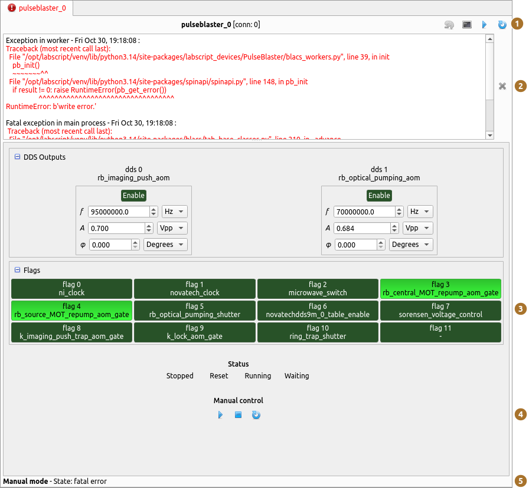
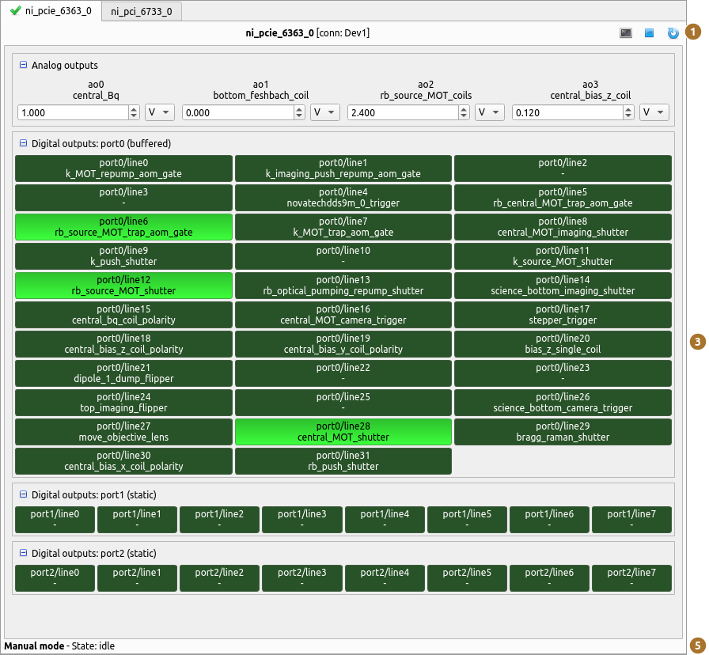
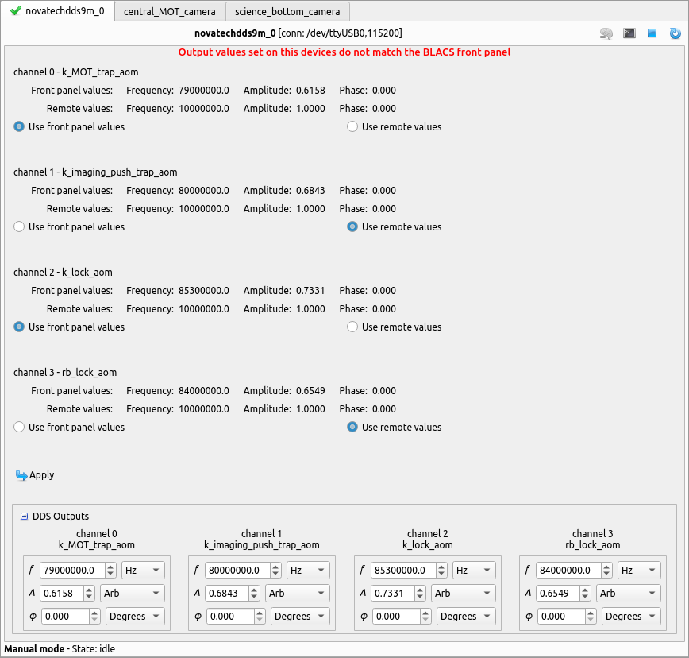
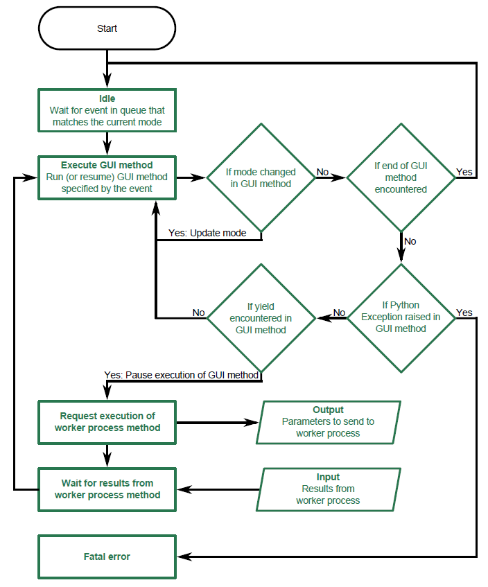

Device Tabs
===========

BLACS creates a tab, in the GUI, for each device it is to control. This information is
sourced from a lab connection table, defined using the labscript API, which is kept up to
date with the current configuration of hardware in the lab. Much of the BLACS GUI is thus
dynamically generated, creating an interface suited to a particular apparatus configuration
rather than enforcing a particular style. These tabs encapsulate three components: the code
that produces the graphical interface, the worker process(es) (which communicate with the
actual hardware), and a state machine which handles communication between the GUI and
the worker process(es).

The graphical interface
-----------------------

Each tab GUI is generated from a set of standard components in order to bring uniformity
to the control of heterogeneous hardware. This also simplifies the process of adding support
for new hardware devices (see :doc:`labscript-devices:adding_devices`) as the author of the device code does not require
knowledge of the GUI widget toolkit. Each tab comprises the following sections (see :numref:`fig-PulseBlaster-Tab` 
and :numref:`fig-PCIe6363-Tab`):

#. device management shortcuts (such as restarting the device),
#. a region (usually hidden) for displaying error messages from the worker process,
#. arrays of ‘manual’ controls for interacting with each of the device’s input and output
   channels when shots are not running,
#. custom controls specific to a particular device (for example status indicators), and
#. the current state of the state machine (see :ref:`device-tabs:State machine`).

.. _fig-PulseBlaster-Tab:

    An example of a BLACS tab for a PulseBlaster DDS-II-300-AWG device, the worker of which
    has failed to start because no board is connected. The numbered labels match
    the listing in :ref:`device-tabs:The graphical interface`.

.. _fig-PCIe6363-Tab:

    An example of a BLACS tab for an NI PCIe-6363 device. The numbered labels match the
    listing in :ref:`device-tabs:The graphical interface`; this device has no custom
    controls, and its error region is hidden because its worker has no error.

The most prominent feature is the arrays of manual controls. These are particularly
useful for manual debugging of an experiment apparatus outside of running shots. For
easy identification, each channel is automatically named with both the hardware output
port, and any assigned name from the lab connection table. All analog values also have
an associated dropdown list, where the current unit is displayed. Unit conversions are
automatically determined from the lab connection table (where they are defined using the
labscript API). This makes debugging simpler as you can immediately be sure of
the output quantity in real world units (for example, the strength of a magnetic field). All
output controls can be locked via a right-click context menu to prevent accidental change
of their state, which is particularly important when controlling sensitive equipment that
can be damaged. For analog quantities, the default step size used when incrementing or
decrementing the value [1]_ can also be customised via the right-click context menu.

The values displayed in the manual controls are also coupled to the hardware device
capabilities. The device code that programs the hardware (see worker processes in :ref:`device-tabs:Worker processes`)
has the ability to return a new value for each channel, each time the device is programmed,
allowing the quantised, rounded or coerced value to be returned such that the manual control
faithfully displays the output state. BLACS also provides an architecture to periodically
poll device values for devices that support such queries. This is particularly important for
devices that are not physically restricted to being controlled by a single user (for example,
devices controlled via a web interface) or devices that don’t remember their state after
being power cycled. For such devices, BLACS compares the device state with
the values displayed in the GUI every 30 seconds in manual mode. If a difference is detected, BLACS presents the user with
options to select either the device state or the local state on a per output basis (see 
:numref:`fig-monitoring`).

.. _fig-monitoring:

    An example showing how devices in BLACS can monitor the consistency between
    the front panel state and the output of the device (when not running a shot). The
    NovaTech DDS9m shown has been power cycled, which resets its outputs to a default
    setting. BLACS detects an inconsistency between the front panel values of BLACS and the
    output state reported by the device, and presents the GUI pictured above. The user can
    then choose either the local or the remote value for each output channel. Once
    selected, the front panel values of BLACS are updated to the selected value and the
    device is reprogrammed to match, restoring consistency.

Worker processes
----------------

For each device, BLACS starts at least one separate Python process (a worker process)
for communicating with the hardware. BLACS communicates with the worker processes
through zprocess, which sends messages over ZMQ sockets. A worker process runs an
instance of a worker class of the device, and BLACS calls methods of that instance
remotely. The tab's state machine (see :ref:`device-tabs:State machine`) sends these
calls to the worker. A worker process only processes the data that is sent to it with
each call, interacts with the hardware device(s) that it manages, and returns the
results to the tab. A third party software library that is used to interact with a
hardware device (typically provided by the hardware manufacturer) is loaded only in
the worker process. Details on writing the code for a worker process can be found in
:doc:`labscript-devices:adding_devices`.

A device tab can start several worker processes. This is useful for devices that handle
both inputs and outputs, and the API of which allows these inputs and outputs to be
managed by separate processes. An example is a National Instruments acquisition card
such as the NI PCIe-6363. For this device, BLACS starts up to three worker processes: the
first handles analog and digital outputs, the second handles analog acquisition and the
third monitors a counter in order to measure the durations of any waits.

Each device is programmed by its own worker processes, so devices that are programmed at
the same time before a shot (see :doc:`shot-management`) are programmed in parallel. Most
device programming is limited by communication with the device rather than by the
processing power of the PC, so the programming of a group of devices typically takes as
long as the programming of the slowest device in the group.

State machine
-------------

Each device tab has a state machine, which controls when the code of the device tab runs
and when it calls the methods of its worker processes. For example, the manual controls
on the BLACS front panel must not program a device while it is running a shot. The state
machine either discards such requests or queues them until the device is back in manual
mode.

The code of a device tab that the state machine runs is in methods of the device tab
class, called state functions. A state function is a method decorated with
`define_state`. Calling a state function does not run it; the call is added to the
tab's queue of states and returns `None` immediately. The state machine runs the queued
calls one at a time.

The state machine has four modes:

* `MODE_MANUAL`,
* `MODE_TRANSITION_TO_BUFFERED`,
* `MODE_BUFFERED`, and
* `MODE_TRANSITION_TO_MANUAL`.

These four modes represent the two modes of operation of the hardware (manual control from
BLACS, or stepping through instructions during a shot) and the transitions between them,
in which the device is usually programmed. The current mode is the `mode` attribute of
the tab, which state functions set.

The arguments of `define_state` are the modes in which the state function may run
(several modes are combined with ``|``), whether a call that may not run in the current
mode stays in the queue until the tab enters such a mode (`True`) or is discarded when the
state machine takes the next call from the queue (`False`), and the optional
`delete_stale_states`. If
`delete_stale_states` is `True` and the queue holds several consecutive calls of the
state function, only the last of them runs. This is useful for state functions that
take a long time to run and can be queued rapidly, for instance when a user changes the
output values of a device that is slow to program.

Calls are added to the queue in response to user actions (for example clicking one of
the manual control buttons), by the queue manager when it runs a shot (see
:doc:`shot-management`), and by timers (for example for regular status checks of the
hardware, with `statemachine_timeout_add`).

The state machine runs each state function in the main thread of BLACS, from the Qt
event loop, so that state functions can update the GUI. A state function that is a
generator yields the calls that it makes to the worker processes:

.. code-block:: python

    result = yield self.queue_work('worker_name', 'worker_method_name', *args, **kwargs)

The state machine then pauses the state function, and a separate thread of the tab sends
the call to the named worker process and waits for its result. The main thread
continues to process GUI events in the meantime. When the result arrives, the state
machine resumes the state function in the main thread, with the result as the value of
the `yield` expression. If the worker method raises an exception, the traceback is
shown in the error area of the tab and the value of the `yield` expression is `None`.
The state machine runs the next queued call once the state function has returned. If a
state function raises an exception, the tab enters the fatal error state: it runs no
further state functions, ends its worker processes and shows the traceback. The tab must
then be restarted.

The state label of the tab shows the mode and the state: `idle`, the name of the state
function followed by `(GUI)` while it runs in the main thread, the name of a worker
method and the worker process while the tab waits for the worker, `fatal error`, or
`stopped` once the stop button has ended the worker processes. The logic of the state
machine is shown in :numref:`fig-statemachine`.

.. _fig-statemachine:

    A flowchart of the logic of the state machine of a device tab, as described in
    :ref:`device-tabs:State machine`.

The following is a simplified version of the state function that programs a device for
a shot, `transition_to_buffered`, and of the state function that it calls if
programming fails:

.. code-block:: python

    from blacs.device_base_class import (
        DeviceTab,
        define_state,
        MODE_MANUAL,
        MODE_TRANSITION_TO_BUFFERED,
        MODE_BUFFERED,
    )

    class MyDeviceTab(DeviceTab):
        # Run only in MODE_MANUAL, and keep the call in the queue until the tab is in
        # that mode:
        @define_state(MODE_MANUAL, True)
        def transition_to_buffered(self, h5_file, notify_queue):
            self.mode = MODE_TRANSITION_TO_BUFFERED
            front_panel_values = self.get_front_panel_values()
            # Call transition_to_buffered() in the worker process and wait for its
            # result:
            final_values = yield self.queue_work(
                self.primary_worker,
                'transition_to_buffered',
                self.device_name,
                h5_file,
                front_panel_values,
                True,
            )
            if final_values is not None:
                self.mode = MODE_BUFFERED
                notify_queue.put([self.device_name, 'success'])
            else:
                notify_queue.put([self.device_name, 'fail'])
                # Queue a call of another state function:
                self.abort_transition_to_buffered()

        @define_state(MODE_TRANSITION_TO_BUFFERED, False)
        def abort_transition_to_buffered(self):
            success = yield self.queue_work(
                self.primary_worker, 'abort_transition_to_buffered'
            )
            if not success:
                raise RuntimeError('Could not abort transition_to_buffered')
            self.mode = MODE_MANUAL
            self.program_device()

When the queue manager calls `transition_to_buffered`, the call stays in the queue until
the tab is in `MODE_MANUAL`. The state function then sets the mode to
`MODE_TRANSITION_TO_BUFFERED`, and yields a call of the worker method
`transition_to_buffered`, which typically programs the device with the hardware
instructions from the shot file. If the worker method succeeds, the state function sets
the mode to `MODE_BUFFERED` and notifies the queue manager. If it fails, the state function
notifies the queue manager and queues a call of `abort_transition_to_buffered`. The
class :class:`blacs.device_base_class.DeviceTab` implements these state functions for every
device, in a similar way, for any number of worker processes. Further information on
adding support for new devices is in :doc:`labscript-devices:adding_devices`.

Handling waits
--------------

In order to use waits, one of the devices in BLACS must measure the duration of each wait
so that a mapping between labscript time and experiment time can be made. Analog
acquisition devices in BLACS use this mapping to break up acquired traces into the
requested acquisitions. Each wait has a timeout, after which the shot continues, so that
the experiment cannot wait forever.

The wait monitor is implemented by the worker processes of the device that is the wait
monitor of the shot: a counter of a National Instruments acquisition device, a
PrawnBlaster or a NarwhalPulseGenerator. At the end of a shot, the wait monitor writes
the durations of the waits to the shot file and then broadcasts the ZMQ event
`wait_durations_analysed`. Device code that relies on the wait durations (for example, for
breaking up analog acquisitions into the requested set of traces) waits for this event
during the transition to manual mode, so that the measured durations of the waits are in
the shot file when it reads them.

.. rubric:: Footnotes

.. [1] Incrementing or decrementing the value can be done using the up/down arrows next to the value, the
    mouse scroll wheel, or the arrow keys on the keyboard. The page up/down keys can also be used, which
    will adjust the value by 10 times the step size. This is distinct from typing a value directly into the
    widget, which is not affected by the step size. Both incrementing/decrementing and typing
    a value in are affected by any quantisation demanded by the hardware device, which is
    described in the following paragraph.
