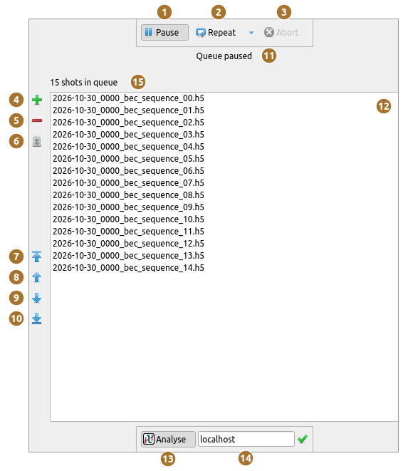
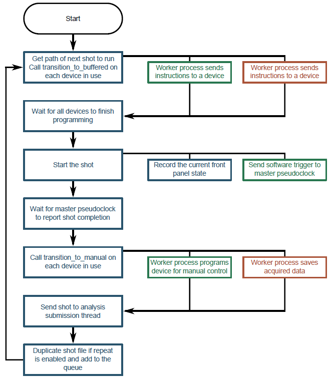

Shot Management
===============

The primary purpose of BLACS is to execute experiment shots on the lab apparatus. File
paths to shots are typically received by BLACS over ZMQ, but can also be loaded directly
through the BLACS GUI (either via the file menu, or by dragging and dropping onto the
queue). Prior to accepting the shot, BLACS compares the connection table of the shot to the
lab connection table and ensures that the shot is compatible with the current configuration of
the laboratory hardware. Connection table compatibility requires that the shot connection
table is a subset of the lab connection table. This ensures that old experiments can not be
run on hardware that is no-longer configured correctly, preventing damage or unexpected
results. Shots that pass this check are added to a queue, which is visible in the BLACS
GUI (see :numref:`fig-queue`).

.. _fig-queue:

    The queue manager GUI within BLACS (with the device tabs hidden). (1)
    The pause button stops the queue from processing new shots (a currently running shot
    will finish). (2) The repeat button, with the drop-down menu that selects its mode. When
    the button is checked, a completed shot is added to the end of the queue again: in the
    'Repeat all' mode every completed shot is added, and in the 'Repeat last' mode a
    completed shot is added only if the queue is empty. (3) The abort button immediately
    stops the execution of the current shot and returns hardware to manual mode. (4-5)
    Buttons to add shots to the queue and to delete the selected shots from it. (6) A button
    to clear the entire queue. (7-10) Buttons to reorder selected shots within the queue.
    (11) The current status of the queue is displayed here. For example, the status may
    indicate that devices are currently being programmed, the master pseudoclock has been
    triggered and the experiment is running, or that acquired data is currently being saved
    into the hdf5 shot file. (12) The list of shot files in the queue, in the order in which
    they will be executed (the topmost is executed first). (13) A button to enable or
    disable the forwarding of shots to lyse for analysis. (14) The network hostname of the
    PC running lyse; the tick to its right shows that the lyse server at that host
    responds. (15) The number of shots in the queue.

The queue is processed by a thread in BLACS, the queue manager, which takes the top-most
shot in the queue and executes it. Shot execution follows this pattern (a flowchart of
this process is also shown in :numref:`fig-flowchart`):

#.  The devices in use in the shot are programmed for hardware-timed execution of the shot
    in groups, in the order of their `start_order` (see :class:`labscript.Device
    <labscript.base.Device>`). Devices without a `start_order` have the order 0. The queue
    manager calls the `transition_to_buffered` state function of the tab of every device in
    a group (see :ref:`device-tabs:State machine`), with the path to the shot file, and the
    devices of the group program in parallel. Each device tab passes the path to its worker
    processes, which read the hardware instructions and program the hardware. During
    programming, the device tab is in the mode `MODE_TRANSITION_TO_BUFFERED`.
#.  The queue manager waits until every device of the group has reported that it is
    programmed, and is in the mode `MODE_BUFFERED`, before it programs the next group. If
    the devices are not all programmed within 5 minutes, or a device reports an error
    during programming, the queue manager aborts the shot: it pauses the queue, instructs
    all device tabs to abort, and puts the shot back at the top of the queue.
#.  When all devices are programmed, the queue manager starts the shot. It records the
    current state of all manual controls, which usually set the initial values of the
    shot, and instructs the master pseudoclock to begin executing the programmed
    instructions. The state of the manual controls is then written to the shot file.
#.  The queue manager waits for the master pseudoclock to report that the shot has
    completed. If an error occurs in a device tab during a shot, the queue manager aborts
    the shot as before.
#.  Once a shot has completed, the queue manager instructs the device tabs to transition
    to manual mode, in groups in the order of their `stop_order`. The device tabs enter the
    mode `MODE_TRANSITION_TO_MANUAL`, in which they save any acquired data and program the
    hardware devices for manual operation from the BLACS GUI. If errors occur during this
    process, the queue manager pauses the queue, removes the acquired data from the shot
    file, so that the file is in the state that it was in before it was run, and puts the
    shot back at the top of the queue.
#.  The path to the shot file is sent to a separate thread that submits shots to lyse for
    analysis. If analysis submission is enabled, this thread sends the path to the lyse
    server named in the BLACS GUI (see :numref:`fig-queue` (13–14)). If lyse does not
    respond, the thread keeps the shot file paths until lyse responds, so that no shots are
    missing from the analysis.
#.  Finally, if the repeat button is checked, the queue manager copies the shot file
    without the acquired data and adds the copy to the end of the queue: always in the
    'Repeat all' mode, and only if the queue is empty in the 'Repeat last' mode.

.. _fig-flowchart:

    A flowchart of the logic of the BLACS queue manager. The flowchart does not show the
    programming of devices in groups, pausing the queue from the GUI, or the handling of
    error conditions. See the list above for further details.
